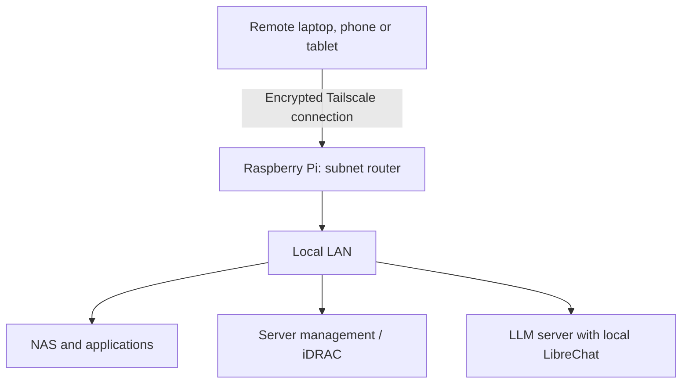

# Tailscale Lab

Private access to a local network through a Raspberry Pi running Tailscale in Docker Compose.

The Pi acts as a subnet router, allowing remote devices to reach NAS interfaces, self-hosted applications, local LLM servers with LibreChat, and server management interfaces such as iDRAC. Destination devices do not need their own Tailscale installation.

## Architecture



The Pi sits behind the existing local router. DHCP remains on that router. Tailscale attempts a direct connection and can fall back to an encrypted relay. The tunnel terminates on the Pi; use application encryption such as HTTPS for the LAN connection where appropriate.

No exit node is configured: this setup provides access to the advertised LAN subnet rather than routing all client internet traffic through the local network.

## Tested environment

| Component | Observed configuration |
| --- | --- |
| Host | Raspberry Pi, ARM64, 4 logical CPUs |
| OS | Ubuntu 26.04.1 LTS |
| Docker Engine | 28.1.1 |
| Docker Compose | v2.35.1 |
| Tailscale | 1.104.7 |
| Networking | Host networking, kernel TUN, native nftables |

Testing confirmed a direct connection to the Pi over 4G and successful remote LAN access after selecting native nftables. Reboot recovery and sustained throughput have not yet been tested.

The Compose image tag `stable` is mutable; it does not pin the tested version.

## Repository files

| File | Purpose |
| --- | --- |
| `compose.yaml` | Tailscale subnet router container |
| `.env.example` | Generic configuration template |
| `.gitignore` | Excludes local configuration, state and reports |
| `check_pi_network_os.sh` | Records OS, architecture, addresses and routes |
| `check_tailscale_docker_network_prerequisites.sh` | Checks Docker access, Compose, IPv4 forwarding and TUN |

Local `.env`, `state/` and `reports/` must remain excluded from Git. Each installation generates its own Tailscale identity; do not copy another installation's state.

## Requirements

- Linux host with Docker Engine and the Docker Compose plugin.
- Deployment account with access to the Docker daemon.
- Host TUN device at `/dev/net/tun`.
- IPv4 forwarding enabled on the host.
- A Tailscale account and a remote device running its client.
- LAN connectivity from the Pi to the destination services.

The prerequisite script reports failures with a corrective action and returns exit code `1` if a required check fails. It does not configure the host or prove end-to-end routing.

## Setup

### 1. Clone

```bash
git clone https://github.com/o-ristow/Tailscale_Lab.git
cd Tailscale_Lab
```

### 2. Check the host

```bash
chmod +x check_pi_network_os.sh check_tailscale_docker_network_prerequisites.sh
./check_pi_network_os.sh
./check_tailscale_docker_network_prerequisites.sh
```

Review the network report before choosing the subnet to advertise. Resolve failed checks before continuing. Timestamped reports are saved locally under `reports/`.

### 3. Configure

For a fresh clone:

```bash
cp .env.example .env
chmod 600 .env
nano .env
```

Set the device name and actual LAN subnet. Example:

```dotenv
TAILSCALE_HOSTNAME=raspberry-hostname
TAILSCALE_ROUTES=192.168.1.0/24
```

If `.env` already exists, edit it instead of overwriting it. Commit only the generic `.env.example` template. Browser authentication is used; no auth key is required in this file.

### 4. Validate and start

```bash
docker compose config --quiet
./check_tailscale_docker_network_prerequisites.sh && docker compose up -d
```

The container uses host networking, `/dev/net/tun` and `NET_ADMIN`. The `userns_mode: host` override supports this setup on hosts with Docker user namespace remapping enabled.

### 5. Authenticate

```bash
docker compose logs --tail=50 tailscale
```

Open the newest authentication URL locally and complete login. Do not publish these URLs or the contents of `state/`.

Verify:

```bash
docker compose exec tailscale tailscale status
```

The configuration allows ten minutes for startup authentication and stores device identity persistently in `state/`.

### 6. Approve the subnet

Open the [Tailscale admin console](https://login.tailscale.com/admin/machines), find the Pi and approve the advertised subnet in its route settings.

Route approval and access policy are separate controls. Ensure the tailnet policy permits the intended users and destinations.

### 7. Test externally

1. Use mobile data or another external network.
2. Connect the remote device's Tailscale client.
3. Test connectivity to the Pi.
4. Open an existing LAN service using its LAN address and port.

A successful ping to the Pi proves tunnel connectivity. Accessing a service behind it verifies subnet forwarding.

## Troubleshooting

### Host networking and user namespaces

Error:

```text
cannot share the host's network namespace when user namespaces are enabled
```

The Compose configuration uses:

```yaml
network_mode: host
userns_mode: host
```

This override applies to the Tailscale container. It does not disable remapping globally.

### Browser login succeeds, but the container is logged out

Inspect logs:

```bash
docker compose logs --since=15m --tail=150 tailscale
```

During setup, startup timed out after 60 seconds, causing restarts and new authentication URLs:

```text
failed to auth tailscale: tailscale up failed: context deadline exceeded
```

The configuration extends the startup timeout:

```yaml
TS_BOOT_TIMEOUT: "10m"
```

After recreation, use the newest login URL. A successful browser login for an earlier attempt does not establish the current instance's authentication state.

### The Pi responds, but LAN services time out

First verify that the Pi can reach the destination. Replace this example address:

```bash
curl -k -I --connect-timeout 5 --max-time 10 https://192.168.1.10
```

`-k` bypasses certificate validation for this diagnostic, useful for self-signed management interfaces.

Then inspect Tailscale health:

```bash
docker compose exec tailscale tailscale status
```

In this lab, the host used nftables-backed iptables, while the container selected legacy iptables. Tailscale failed to create `ts-input` because the legacy filter table was unavailable. The prerequisite checks had passed, but the runtime firewall setup had failed.

The working configuration selects native nftables:

```yaml
TS_DEBUG_FIREWALL_MODE: "nftables"
```

This resolved the observed forwarding failure. The variable is officially documented, but its interface is subject to change. Other hosts may also need investigation of forwarding rules and access policies; disabling the host firewall is not a general solution.

Apply configuration changes:

```bash
docker compose config --quiet && docker compose up -d
```

## Operations

Status and logs:

```bash
docker compose ps
docker compose exec tailscale tailscale status
docker compose logs --tail=100 tailscale
```

Resource usage:

```bash
docker stats --no-stream
```

Stop and start:

```bash
docker compose stop
docker compose start
```

No hard CPU or memory limits are configured. Initial usage was low; demand under sustained traffic has not been measured.

`restart: unless-stopped` provides automatic restarts after unexpected exits. It is not an end-to-end health guarantee.

## Follow-up validation

- Repeat authentication and LAN access checks after container recreation and a host reboot.
- Verify IPv4 forwarding persists across reboot.
- Measure throughput and resource use under load.
- Record or pin an image version for reproducibility.
- Review access policies before adding other users.

## References

- [Subnet routers](https://tailscale.com/docs/features/subnet-routers)
- [Docker configuration parameters](https://tailscale.com/docs/features/containers/docker/docker-params)
- [Firewall mode](https://tailscale.com/docs/features/firewall-mode)
- [Container startup settings](https://github.com/tailscale/tailscale/blob/main/cmd/containerboot/settings.go)

## License

See [LICENSE](LICENSE).
